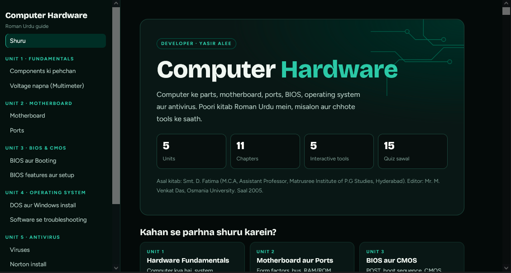
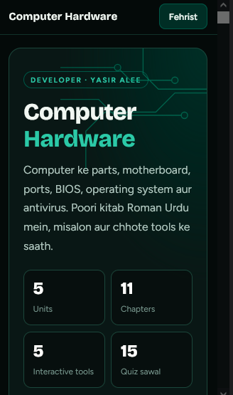

  <h1>Computer Hardware</h1>
  
<b>Easy In Roman Urdu Language</b>

  <a href="https://your-username.github.io/your-repo-name/](https://ya78692110.github.io/Computer-Hardware/"><strong>🌐 Live Demo View »</strong></a>

 

---

## 🚀 Key Features

*  **About:** Computer Hardware
*  **Language:** Easy Roman Urdu
*  **Theme:** Dark Green, Black & White

---

## 🛠️ Tech Stack

  
  
  

---

## 📸 Preview

> 

---

